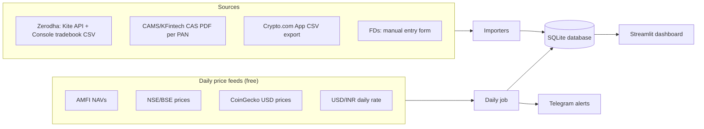
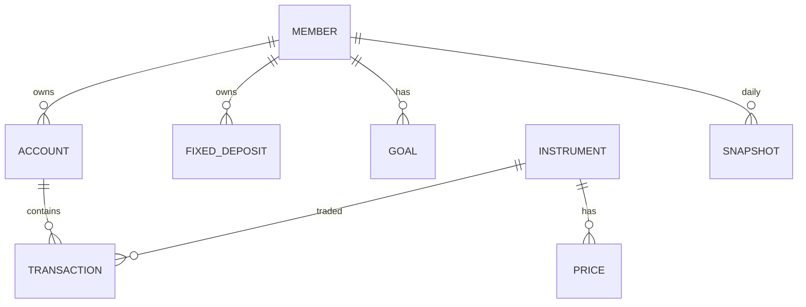

# Family Investment Portfolio Dashboard: Design Document

| | |
|---|---|
| **Status** | Implemented (all phases); see `README.md` for usage |
| **Date** | 14 Oct 2026 |
| **Location** | `d:\investment_portfolio_project` |

---

## 1. Goal

A single dashboard giving an overview of all family investments across:

- Cryptocurrency
- Indian stock market
- Indian mutual funds
- Fixed deposits in Indian banks

The process should be automated as much as possible.

## 2. Requirements

| Topic | Decision |
|---|---|
| Stock broker | Zerodha |
| Mutual funds | Bought via apps and directly with AMCs (not in demat) |
| Crypto | Crypto.com **mobile App** (no public API); tracked in **US dollars** |
| Tax residency | Owner is an **NRI** (tax resident of Singapore); set per family member |
| Hosting | Local only, on a Windows PC |
| UI | Streamlit (simple, pure Python) |
| Users | Me and family members (multiple PANs) |
| Features | Net worth history, asset allocation, XIRR and profit/loss, tax reports, FD maturity reminders, Telegram alerts, goal tracking |
| Builder's coding experience | Beginner; the system is built for the user, with clear run instructions |
| Python installed? | No; installing it is part of setup |

## 3. Technology stack

| Layer | Choice | Why |
|---|---|---|
| Language | Python 3.12 | Has the best libraries for Indian finance data (`casparser`, `kiteconnect`) |
| UI | Streamlit + Plotly | Interactive web dashboard written entirely in Python; runs in the browser |
| Database | SQLite (via SQLAlchemy) | A single file with no server and nothing to set up; can move to PostgreSQL later |
| Calculations | `pandas`, `pyxirr` | Holdings, profit/loss, and XIRR |
| Scheduler | Windows Task Scheduler | Runs daily and weekly jobs even when the dashboard is closed |
| Alerts | Telegram Bot API | Free, instant, works on mobile |
| Secrets | `keyring` (Windows Credential Manager) | No plain-text API keys or passwords |

**Main libraries:** `streamlit`, `plotly`, `pandas`, `sqlalchemy`, `casparser`, `kiteconnect`, `yfinance`, `pyxirr`, `keyring`, `requests`, `pyyaml`, `pytest`.

## 4. Architecture



Everything runs on the local PC. The dashboard is served at `http://localhost:8501` and can't be reached from the internet.

## 5. Data sources and automation level

| Asset | Holdings and transactions | Current price | Manual effort |
|---|---|---|---|
| Stocks | Zerodha Console **tradebook CSV** (full history), plus optional **Kite Connect API** for live holdings | Kite API or `yfinance` (`SYMBOL.NS`) | Export the CSV once a month; daily Kite login is optional |
| Mutual funds | **CAMS/KFintech CAS PDF** (complete history across all apps and AMCs) | AMFI daily NAV file (`NAVAll.txt`) | Request the statement by email once a month per family member (PAN) |
| Crypto | **Crypto.com App transaction CSV** (USD values) | CoinGecko API (in USD) | Export the CSV once a month |

**Currencies:** crypto costs, prices and gains are stored and shown in USD. Net worth and other totals are in INR:
current value converts at today's USD/INR rate, cost at the rate on each purchase date (rates from Yahoo Finance, stored daily).
| Fixed deposits | Manual entry form | Calculated from principal, rate and compounding | Once per FD |

### Known limitations

1. **Zerodha Kite API login expires daily.** Each family member also needs their own Kite Connect app. The tradebook CSV is therefore the main source, and the API is optional.
2. **The Kite API only gives the average buy price.** Accurate XIRR and capital gains need the full tradebook CSV.
3. **The Crypto.com App has no public API.** Holdings come from its CSV export; prices refresh automatically.
4. **Banks have no API for FDs.** The RBI Account Aggregator framework needs a regulated licence, so it isn't practical for personal use.
5. **The CAS PDF is password protected,** usually with the PAN. The password is stored in Windows Credential Manager.

## 6. Data model



| Table | Key fields |
|---|---|
| `member` | name, relation, PAN (last 4 characters only), tax slab |
| `account` | member, type (`zerodha` / `mf_folio` / `cryptocom`), label, folio or client ID |
| `instrument` | asset class, name, ISIN, NSE symbol, AMFI code, CoinGecko ID, category (equity / debt / hybrid / gold) |
| `transaction` | account, instrument, date, type (buy / sell / SIP / switch / dividend / bonus / split), units, price, amount, fees, TDS |
| `price` | instrument, date, price (one per instrument per day) |
| `fixed_deposit` | member, bank, principal, rate, start date, maturity date, compounding, payout type, auto-renew, TDS, status |
| `snapshot` | date, member, asset class, invested amount, current value (powers the history chart) |
| `goal` | name, member (optional), target amount, target date, linked holdings or asset classes |
| `import_log` | file name, hash, date, row count (prevents duplicate imports) |
| `alert_log` | alert type, key, date sent (prevents duplicate alerts) |

**Rule:** holdings are always calculated from transactions using FIFO (first in, first out), never stored separately, so all numbers stay consistent.

## 7. Dashboard pages

A sidebar filter switches between the **whole family** and **any one member**.

1. **Overview:** total net worth, today's change, overall XIRR, allocation by asset class and by member, net worth history chart, upcoming FD maturities.
2. **Stocks:** each holding with quantity, average cost, current value, profit/loss, XIRR, and sector split.
3. **Mutual funds:** each scheme with invested amount, value, XIRR, and equity/debt split. Active SIPs are detected automatically.
4. **Crypto:** each coin's holding, value, profit/loss and XIRR in USD, with the INR equivalent.
5. **Fixed deposits:** FD list (Regular / NRO / NRE), value accrued so far, maturity calendar, interest per financial year and whether TDS applies.
6. **Tax:** capital gains for any financial year, plus an Excel export for a chartered accountant (CA).
7. **Goals:** progress bars, the monthly investment needed to stay on track, and projections.
8. **Import:** drag-and-drop upload of statements, with a preview before saving.
9. **Settings:** family members, Telegram setup, tax rules, backup location.

## 8. Tax rules

Tax rules are stored in `config/tax_rules.yaml` so they can be updated after each Budget without changing code.

| Asset | Treatment |
|---|---|
| Listed equity and equity mutual funds | Short-term if held 12 months or less, long-term otherwise; long-term gains above ₹1.25 lakh per year are taxable |
| Debt mutual funds (bought on or after 1 Apr 2023) | Taxed at the income tax slab rate |
| Crypto (VDA, virtual digital assets), resident | Flat 30% plus cess on INR gains; losses can't be set off |
| Crypto on a foreign platform, **NRI** | Not taxed in India |
| NRE FD interest, **NRI** | Tax-free in India; NRO FD interest is taxed at slab rate with TDS |
| FD interest | Taxed at the slab rate; TDS tracked |

## 9. Automation and alerts

Scheduled with Windows Task Scheduler:

| When | Job |
|---|---|
| Daily at 7:00 AM | Fetch the previous day's NAVs and stock closing prices, refresh crypto prices, save the daily snapshot, check alerts, send a Telegram summary |
| Hourly (optional) | Refresh crypto prices and send price-drop alerts |
| Daily | FD maturity reminders 30, 7 and 1 day before maturity |
| Weekly | Back up the database to a chosen folder (for example, OneDrive) |
| 1st of each month | Telegram reminder to download the month's statements |

**Telegram alerts:** daily net worth summary, any holding falling more than a set percentage, FD maturities, goal milestones, and a reminder before 31 March to book long-term gains within the ₹1.25 lakh exemption.

## 10. Security

- All data stays on the local PC; nothing is uploaded.
- API keys, the Telegram token and statement passwords are stored in Windows Credential Manager through `keyring`.
- Only the last 4 characters of each PAN are stored.
- `data/` (the database and uploaded statements) is git-ignored and excluded from any sync except encrypted backups.
- Streamlit only listens on `localhost`.

## 11. Project structure

```text
investment_portfolio_project/
├── app.py                  # Streamlit entry (Overview page)
├── pages/                  # Stocks, MF, Crypto, FD, Tax, Goals, Import, Settings
├── core/
│   ├── db.py, models.py    # SQLite + SQLAlchemy models
│   ├── holdings.py         # positions from transactions (FIFO)
│   ├── returns.py          # XIRR, P&L
│   ├── tax.py              # Indian capital gains rules
│   └── fd.py               # FD interest/maturity maths
├── importers/              # zerodha_tradebook, kite_api, cas_pdf, cryptocom_csv
├── prices/                 # amfi, nse (yfinance), coingecko
├── jobs/                   # daily_job.py, alerts.py, backup.py
├── config/tax_rules.yaml   # editable tax rates
├── data/                   # portfolio.db, uploads (git-ignored)
├── docs/                   # this document
├── tests/
├── requirements.txt
└── start_dashboard.bat     # double-click to open the dashboard
```

## 12. Build phases

| Phase | Scope | Usable result |
|---|---|---|
| **0. Setup** | Install Python 3.12 (via `winget`), create a project environment (`venv`), install libraries | Working environment |
| **1. Foundation** | Database, family members, FD entry, Overview and FD pages | FDs tracked with maturity calendar |
| **2. Mutual funds** | CAS PDF import, daily AMFI NAVs, XIRR, mutual fund page | Complete mutual fund portfolio |
| **3. Stocks** | Zerodha tradebook import, optional Kite API, stocks page | Complete stock portfolio |
| **4. Crypto** | Crypto.com CSV import, CoinGecko prices, crypto page | Complete crypto portfolio |
| **5. Automation** | Daily job, snapshots and history chart, Telegram alerts, backups | Hands-off daily updates |
| **6. Analysis** | Tax reports, goals, Excel export | Tax-time and planning tools |

Each phase ends with a one-click `start_dashboard.bat` and short instructions for that phase.

## 13. Monthly routine (for the user)

1. Request the CAS statement from the CAMS or KFintech website for each family member. It arrives by email.
2. Download the Zerodha Console tradebook for each family member.
3. Export the Crypto.com App transaction history (CSV).
4. Open the dashboard, go to **Import**, and drag in the files.
5. Add any new FDs.

Everything else (prices, NAVs, snapshots, alerts, backups) runs automatically.

## 14. Open questions

- Which phase should be built first after Phase 1?
- Which folder should backups go to (OneDrive, an external drive, or somewhere else)?
- What percentage drop should trigger a price alert (for example 5% in a day)?
