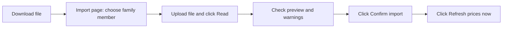

# Runbook: Family Portfolio Dashboard

How to run the app, load each data feed, keep it updated, and fix common problems.

- **Project folder:** `D:\investment_portfolio_project`
- **Dashboard address:** http://localhost:8501 (only reachable from this PC)
- **Design document:** [DESIGN.md](DESIGN.md)

---

## 1. Run the app

### Start

**Option A (easiest):** double-click `start_dashboard.bat` in the project folder. A black window opens and the dashboard opens in your browser.

**Option B (terminal):** open PowerShell and run:

```powershell
cd D:\investment_portfolio_project
.\.venv\Scripts\python.exe -m streamlit run app.py
```

If the browser doesn't open by itself, go to http://localhost:8501.

### Stop

Close the black window, or press `Ctrl + C` in the terminal.

### Run on a different port (if 8501 is busy)

```powershell
.\.venv\Scripts\python.exe -m streamlit run app.py --server.port 8502
```

---

## 2. Where to keep downloaded files

The app doesn't read files from a folder. You upload them on the **Import** page, and only the extracted transactions are saved to the database. Keep the original files **outside the project folder**, for your own records:

```text
D:\Investments\Statements\
├── <Member name>\
│   ├── CAS\          2026-10_CAS_detailed.pdf
│   ├── Zerodha\      tradebook_2024-25.csv, tradebook_2025-26.csv
│   └── CryptoCom\    2026-10_crypto_wallet.csv
└── <Other member>\
```

Never put statements inside `D:\investment_portfolio_project`. That folder is synced to GitHub (`.gitignore` blocks PDF/CSV files as a safety net).

---

## 3. First-time setup (in this order)

| Step | Where | What to do |
|---|---|---|
| 1 | **Settings > Family members** | Add each person: name, relation, tax residency (**NRI** for you), income tax slab |
| 2 | **Import > Mutual funds (CAS)** | Upload each member's CAS PDF (section 4.1) |
| 3 | **Import > Zerodha tradebook** | Upload each member's tradebook CSVs (section 4.2) |
| 4 | **Import > Crypto.com** | Upload the Crypto.com CSV (section 4.3) |
| 5 | **Fixed Deposits** | Add each FD (section 4.4) |
| 6 | Sidebar | Click **Refresh prices now** |
| 7 | **Overview** | Click **Rebuild history from past prices** (takes 1-3 minutes) |
| 8 | **Settings > Telegram alerts** | Connect your Telegram bot (section 6) |
| 9 | Project folder | Right-click `setup_scheduled_tasks.bat` > **Run as administrator**, once (section 5) |

---

## 4. Data feeds

Every import works the same way:



- **Re-importing is safe.** Transactions already in the database are skipped, so overlapping or repeated files never create duplicates.
- **Always pick the correct family member** before uploading, since transactions are filed under that person.
- You can check past imports under **Import > Import history**.

### 4.1 Mutual funds: CAMS/KFintech CAS (PDF)

| | |
|---|---|
| **Format** | PDF, password-protected |
| **One file covers** | All mutual funds under one PAN, from every app and AMC (Groww, Kuvera, direct, etc.) |
| **How often** | Monthly |

**Download**

1. Open the [CAMS CAS request page](https://www.camsonline.com/Investors/Statements/Consolidated-Account-Statement). MF Central and KFintech also issue the same statement.
2. Choose:
   - **Statement type:** Detailed (includes transaction listing)
   - **Period:** Specific period, from **01-Jan-2000** (before your first investment) to **today**
   - **Folio listing:** With zero balance folios
   - **Email and PAN** of the family member
   - **Password** of your choice
3. Submit. The PDF arrives by email in a few minutes. Save it under `Statements\<Member>\CAS\`.

**Upload**

1. **Import > Mutual funds (CAS)**, then choose the **family member**.
2. Drop the PDF and enter the PDF password. Tick **Remember password** to save it in Windows Credential Manager.
3. Click **Read statement**, check the preview, then **Confirm import**.

**Notes**

- Always request the **full period**. Funds you've already sold are needed for correct capital gains and XIRR (annualised return).
- Fund categories (equity, debt, hybrid, gold) are guessed from the scheme type and name. Check them in **Settings > Instruments**; only "equity" gets equity tax rates.
- Mutual funds held in a demat account show up in the NSDL/CDSL statement, which isn't supported. Use the CAMS/KFintech statement.

### 4.2 Stocks: Zerodha Console tradebook (CSV)

| | |
|---|---|
| **Format** | CSV |
| **One file covers** | Equity trades for one Zerodha account, for up to 1 year |
| **How often** | First time: every year since you opened the account. Then monthly. |

**Download**

1. Log in to [Zerodha Console](https://console.zerodha.com) as the family member.
2. Go to **Reports > Tradebook** and set **Segment = Equity**.
3. Choose a date range of at most one year, click **View**, then click the **CSV** download icon.
4. Repeat for each financial year since you opened the account. Save the files as `Statements\<Member>\Zerodha\tradebook_<FY>.csv`.

**Upload**

1. **Import > Zerodha tradebook**, then choose the **family member**.
2. Optionally enter the **Zerodha client ID** (e.g. AB1234). Use the same ID every time.
3. Select **all** the yearly CSV files at once, click **Read tradebooks**, then **Confirm import**.

**Corporate actions (not in the tradebook):** add these under **Import > Manual entry**.

| Event | How to enter it |
|---|---|
| Bonus issue | Type **Bonus shares**, units = bonus shares received, date = allotment date |
| Stock split | Type **Split (ratio)**, units = new shares per old share (e.g. 5 for a 1:5 split), date = record date |
| Shares from outside Zerodha | Type **Buy**, with actual units, amount and date |

**Optional: Zerodha Kite API (checks holdings and gets live prices)**

1. Create an app at [developers.kite.trade](https://developers.kite.trade) with redirect URL `http://127.0.0.1`.
2. **Import > Zerodha Kite API**, choose the member, and enter the **API key** and **API secret** (stored in Windows Credential Manager).
3. Click **Log in to Zerodha** and sign in. You land on a page that won't load; copy its full address from the browser bar and paste it into the app.
4. A table compares Kite holdings with the dashboard. A ❌ in the "matches" column usually means older tradebooks or a bonus/split are missing.
5. The Kite login expires every day (Zerodha's rule). It's only needed when you want to reconcile.

### 4.3 Crypto: Crypto.com App (CSV)

| | |
|---|---|
| **Format** | CSV, amounts recorded in **US$** |
| **One file covers** | All crypto wallet transactions in the chosen date range |
| **How often** | Monthly, or whenever you buy or sell |

**Download**

1. In the **Crypto.com App**, open the **transaction history** (from the Accounts/wallet screen or Settings; the menu name varies by app version).
2. Tap **Export**, choose **Crypto Wallet**, and set the **full date range** (from when you joined to today).
3. The CSV is emailed to you. Save it under `Statements\<Member>\CryptoCom\`.

**Upload**

1. **Import > Crypto.com**, then choose the **family member**.
2. Drop the CSV, click **Read CSV**, check the preview, then **Confirm import**.

**Notes**

- The file must include the **"Native Amount (in USD)"** column. Full exports from the app include it. If your app shows SGD and this column is missing, the import stops and asks you to re-export.
- Fiat wallet and card statements are not needed.
- How rows are treated:
  - **Buys and swaps** become buy/sell transactions.
  - **Rewards and cashback** are added at their market value on the day received.
  - **Withdrawals** to external wallets remove coins without counting as a sale.
  - **Earn/lockup moves** are ignored, because the coins are still yours.
- If a coin shows "no price yet", set its **CoinGecko ID** in **Settings > Instruments**. Find the ID in the coin's coingecko.com page address.

### 4.4 Fixed deposits: manual entry (no file)

1. Go to **Fixed Deposits > Add a fixed deposit**.
2. Enter:
   - **Member, bank, FD type** (Regular / NRO / NRE), FD number (optional)
   - **Principal, interest rate, start date**
   - **Tenure** in months/days, *or* set tenure to 0 and pick the **maturity date**
   - **Compounding** (quarterly for most banks) and **interest payout** (cumulative, or monthly/quarterly payout)
3. Click **Save FD**.

**When an FD matures:** choose it under **Manage an FD**, then:

- **Mark closed** if the money was paid out, or
- **Renew** to close it and create the new FD. The new principal is pre-filled with the maturity amount; adjust the rate if it changed.

---

## 5. Automatic updates (scheduled tasks)

Set up once: right-click **`setup_scheduled_tasks.bat`** and choose **Run as administrator**. Windows only lets an administrator create the "at logon" task; without admin rights, that one fails with "Access is denied" and the other two are still created. This creates three Windows tasks:

| Task | When | What it does |
|---|---|---|
| `PortfolioDashboard\Daily` | Every day at 7:00 AM | Updates NAVs, stock prices, crypto prices and USD/INR; saves the net-worth snapshot; sends Telegram alerts; backs up the database weekly |
| `PortfolioDashboard\AtLogon` | 5 minutes after you log in | Same as Daily (catches up if the PC was off at 7 AM) |
| `PortfolioDashboard\CryptoHourly` | Every hour | Crypto prices and price-drop alerts |

These tasks run even when the dashboard isn't open.

**Run a job by hand** (from the project folder):

```powershell
.\run_job.bat daily     # prices + snapshot + alerts (+ backup if due)
.\run_job.bat crypto    # crypto prices only
.\run_job.bat backup    # back up the database now
.\run_job.bat history   # rebuild net-worth history from past prices
```

**Check or remove the tasks:**

```powershell
schtasks /query /tn "PortfolioDashboard\Daily"
schtasks /delete /tn "PortfolioDashboard\Daily" /f
schtasks /delete /tn "PortfolioDashboard\AtLogon" /f
schtasks /delete /tn "PortfolioDashboard\CryptoHourly" /f
```

**Log file:** `data\logs\jobs.log`

---

## 6. Telegram alerts setup

1. In Telegram, open **@BotFather**, send `/newbot`, and follow the prompts. Copy the **token** it gives you.
2. **Settings > Telegram alerts**: paste the token and click **Save token**.
3. In Telegram, open your new bot and send it any message (e.g. "hi").
4. Click **Find my chat ID**, then **Send test message**.
5. Set the **price-drop alert %** (default 5%) and click **Save alert setting**.

Alerts you'll receive:

- Daily summary
- A holding falling by more than the set percentage
- FD maturing in 30, 7 and 1 days, and on maturity
- Goal milestones (25 / 50 / 75 / 100%)
- In March, tax-free long-term gain booking tips
- On the 1st of each month, a reminder to download statements

---

## 7. Monthly routine (about 10 minutes)

On the 1st of each month (Telegram reminds you), for each family member:

- [ ] Request a new **CAS** (full period) and import it
- [ ] Download last month's **Zerodha tradebook** and import it
- [ ] Export a new **Crypto.com** CSV and import it
- [ ] Add any **new FDs**; close or renew matured ones
- [ ] Add any **bonus/split** entries from the month
- [ ] Glance at **Overview** for warnings (missing prices, unmatched sales)

---

## 8. Backups and restore

- **Automatic:** weekly, as part of the daily job. The last 8 copies are kept.
- **Location:** `data\backups\` by default. Change it in **Settings > Backups**; a OneDrive folder is recommended so a copy exists off this PC.
- **Manual:** **Settings > Back up now**, or `.\run_job.bat backup`.

**Restore a backup**

1. Stop the dashboard.
2. Copy the backup file, e.g. `portfolio_20261014_070000.db`, to `D:\investment_portfolio_project\data\`.
3. Rename it to `portfolio.db`, replacing the existing file.
4. Start the dashboard.

---

## 9. Troubleshooting

| Message or symptom | Cause | Fix |
|---|---|---|
| "Wrong PDF password" | CAS password mistyped | Use the password you set when requesting the CAS |
| "This is a SUMMARY statement" | Wrong CAS type | Request the **Detailed** CAS |
| "This is an NSDL/CDSL demat statement" | Uploaded the depository statement | Upload the CAMS/KFintech CAS instead |
| "This doesn't look like a Zerodha tradebook CSV" | Wrong report (e.g. P&L or holdings) | Download **Reports > Tradebook** as CSV |
| "Skipped N non-equity trades" | File included F&O/currency trades | Normal; only equity is tracked |
| "This doesn't look like a Crypto.com App 'Crypto wallet' transaction CSV" | Fiat/card export uploaded | Export the **Crypto Wallet** history |
| "...without a 'Native Amount (in USD)' column" | Partial export | Re-export the full history from the app |
| "N holding(s) have no price yet" | New instrument, or prices not refreshed | Click **Refresh prices now**. If it persists, fix the NSE symbol, AMFI code or CoinGecko ID in **Settings > Instruments** |
| "Couldn't get the USD/INR exchange rate" | No internet when converting crypto | Reconnect and click **Refresh prices now** |
| "Some sales have no matching purchase" | Older history missing | Import older tradebooks or a full-period CAS |
| Kite holdings don't match | Missing tradebook year, bonus or split | Import older tradebooks, or add bonus/split under **Manual entry** |
| Wrong transaction imported | Mistaken file or member | Stock/MF/Crypto page > **Transactions** > select rows > **Delete** |
| Dashboard won't open | Port in use, or app not running | Run `start_dashboard.bat` again, or use another port (section 1) |
| No Telegram messages | Token or chat ID missing | **Settings > Send test message**; check `data\logs\jobs.log` |

---

## 10. Maintenance

**Save changes to GitHub** (code only; your data is never uploaded):

```powershell
cd D:\investment_portfolio_project
git add -A; git commit -m "Describe the change"; git push
```

**Update tax rules after a Budget:** edit `config\tax_rules.yaml`, then **Settings > Reload tax rules**.

**Run the automated tests:**

```powershell
.\.venv\Scripts\python.exe -m pytest
```

**Set up on a new PC:**

```powershell
winget install -e --id Python.Python.3.12 --scope user
winget install -e --id Git.Git --scope user
git clone https://github.com/bajaj1989/investment-portfolio-dashboard.git D:\investment_portfolio_project
cd D:\investment_portfolio_project
& "$env:LOCALAPPDATA\Programs\Python\Python312\python.exe" -m venv .venv
.\.venv\Scripts\python.exe -m pip install -r requirements.txt
```

Then copy your latest backup to `data\portfolio.db` (see section 8). Re-enter the Telegram token, Kite keys and CAS passwords, because these are stored in each PC's Windows Credential Manager. Finally, run `setup_scheduled_tasks.bat`.
